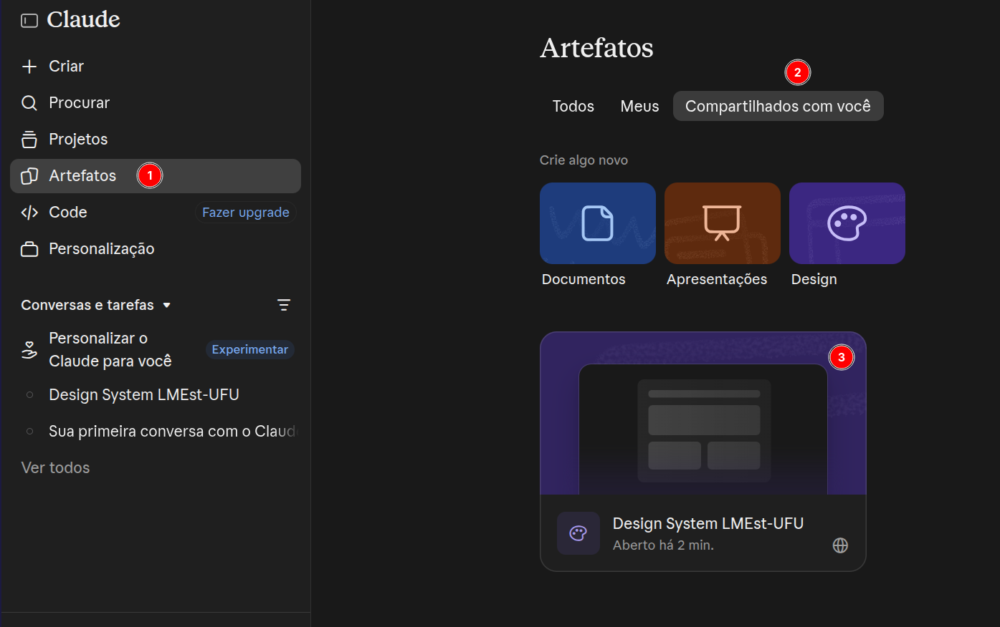
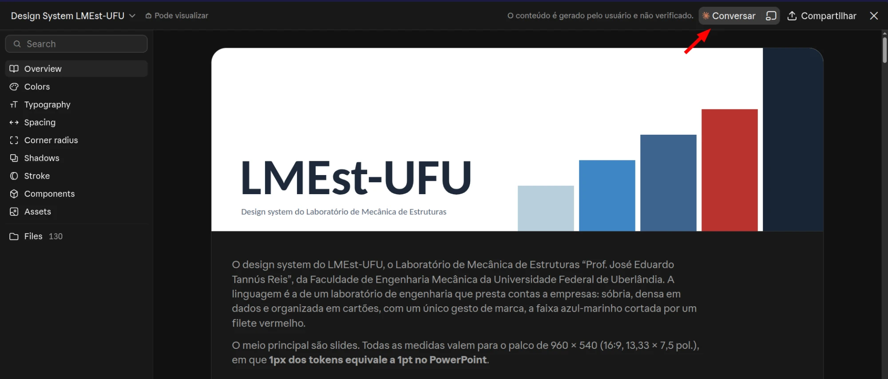
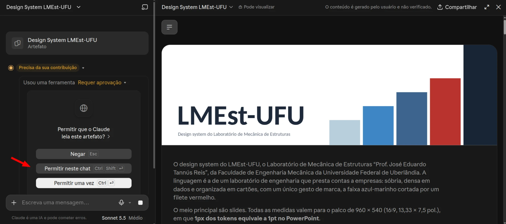

# lmest-llm-toolkit

Repositório do LMEst-UFU para hospedar **skills**, **agents** e demais habilidades (comandos, instruções, MCPs etc.) que estendem o comportamento de assistentes de código baseados em LLM, como **Claude Code**, **Codex** e **Antigravity**.

A ideia é manter tudo em um só lugar, versionado, para que qualquer pessoa do laboratório copie as habilidades para o seu projeto e obtenha os mesmos resultados.

## Conteúdo

| Habilidade | Tipo | Descrição |
|---|---|---|
| [lmest-apresentacao](skills/lmest-apresentacao/) | Skill | Cria e edita apresentações de slides no padrão visual do LMEst-UFU a partir de PPTX, PDF, Word ou Markdown, com saída em HTML offline, PPTX editável e/ou artefato Slides. |
| [lmest-relatorio-html](skills/lmest-relatorio-html/) | Skill | Gera um relatório técnico em HTML único e offline, com a identidade visual do LMEst-UFU, a partir de Markdown ou nota do Obsidian, zip com anexos, PDF ou PPTX. |
| [transcricao-markdown](skills/transcricao-markdown/) | Skill | Transcreve PDFs de artigos, teses e relatórios técnicos para Markdown fiel, com equações em LaTeX, tabelas em Markdown e figuras recortadas em imagens. |

Cada skill é uma pasta autocontida: um `SKILL.md` (instruções e metadados) mais scripts, docs e assets de apoio.

## Como usar

Em todos os ambientes o princípio é o mesmo: **copiar a habilidade desejada para a pasta que a ferramenta lê**, no projeto (escopo local) ou no diretório do usuário (escopo global).

Primeiro, clone o repositório:

```bash
git clone https://github.com/ViniciusTxC3/lmest-llm-toolkit.git
```

### Claude Code

O Claude Code lê habilidades da pasta `.claude/`.

**Jeito mais simples:** não precisa copiar nada à mão. Basta passar ao Claude Code o link da pasta da skill (no GitHub) ou o caminho dela no seu computador, e pedir que ele a instale para você. Exemplo:

```text
Instale no meu projeto a skill que está em https://github.com/ViniciusTxC3/lmest-llm-toolkit/tree/main/skills/lmest-relatorio-html
```

Ou, se você já clonou o repositório:

```text
Instale no meu projeto a skill que está em ~/lmest-llm-toolkit/skills/lmest-relatorio-html
```

Para instalar para todos os seus projetos, peça que ela seja instalada globalmente, em `~/.claude/skills/`.

Se preferir fazer manualmente, siga os passos abaixo.

1. Na raiz do seu projeto, crie a pasta `.claude/` (se ainda não existir).
2. Copie o que quiser usar para dentro dela:
   - Skills → `.claude/skills/<nome-da-skill>/`
   - Agents → `.claude/agents/<nome-do-agent>.md`
   - Commands → `.claude/commands/<nome>.md`
3. Abra o Claude Code no projeto. As skills são descobertas automaticamente e podem ser invocadas por `/<nome-da-skill>` ou acionadas pelo Claude quando a descrição combinar com o pedido.

Exemplo (PowerShell), instalando a skill de apresentações em um projeto:

```powershell
New-Item -ItemType Directory -Force "meu-projeto\.claude\skills"
Copy-Item -Recurse "lmest-llm-toolkit\skills\lmest-apresentacao" "meu-projeto\.claude\skills\"
```

Para disponibilizar a habilidade em **todos** os projetos, copie para `~/.claude/skills/` (no Windows, `C:\Users\<usuario>\.claude\skills\`).

### Codex (OpenAI)

O Codex lê instruções do arquivo `AGENTS.md` e, nas versões com suporte a skills, de uma pasta de skills (`.agents/skills/` no projeto ou `~/.codex/skills/` global).

1. Copie a pasta da skill para `.agents/skills/<nome-da-skill>/` (ou `~/.codex/skills/`).
2. Se a sua versão não suportar skills, referencie o `SKILL.md` no `AGENTS.md` da raiz do projeto, por exemplo: "Para gerar apresentações, siga `.agents/skills/lmest-apresentacao/SKILL.md`".
3. Reinicie a sessão do Codex para recarregar.

### Antigravity (Google)

O Antigravity lê workflows e regras da pasta `.agent/` no projeto (global: `~/.gemini/antigravity/`).

1. Crie `.agent/skills/` na raiz do projeto e copie a pasta da skill para lá.
2. Alternativamente, adicione uma regra em `.agent/rules/` ou um workflow em `.agent/workflows/` que aponte para o `SKILL.md`.
3. Reabra o projeto/agente para que as novas habilidades sejam carregadas.

> **Nota:** os caminhos de Codex e Antigravity mudam com frequência entre versões. Confirme na documentação oficial da ferramenta instalada. O conteúdo da skill (`SKILL.md`, scripts e assets) é o mesmo em todos os ambientes; só muda a pasta de destino.

## Design System do LMEst

O Design System é um manual de instruções que possibilita que o Claude crie documentos (como relatórios e apresentações) usando o padrão visual do LMEst. Sem instalar nenhuma skill, dá para pedir o documento ao Claude usando o Design System do LMEst, compartilhado como artefato.

1. Acesse o link: https://claude.ai/artifact/QyGsUH1VCCj4CqknL22zyY
2. Em **Artefatos > Compartilhados com você**, abra **Design System LMEst-UFU**.

   

3. Clique em **Conversar**.

   

4. Quando o Claude perguntar se pode ler o artefato, clique em **Permitir neste chat**.

   

5. Peça o documento. Exemplo:

   ```text
   Crie uma apresentação (ou um relatório) com o Design System do LMEst, com base neste material: [anexe o arquivo ou cole o texto]
   ```

## Contribuindo

1. Crie a habilidade em uma pasta própria dentro de `skills/` (ou `.claude/agents/`).
2. Inclua um `SKILL.md` com `name` e `description` claros, dizendo **quando** usar a habilidade.
3. Documente dependências e exemplos de uso em um `README.md` dentro da pasta.
4. Abra um pull request.
