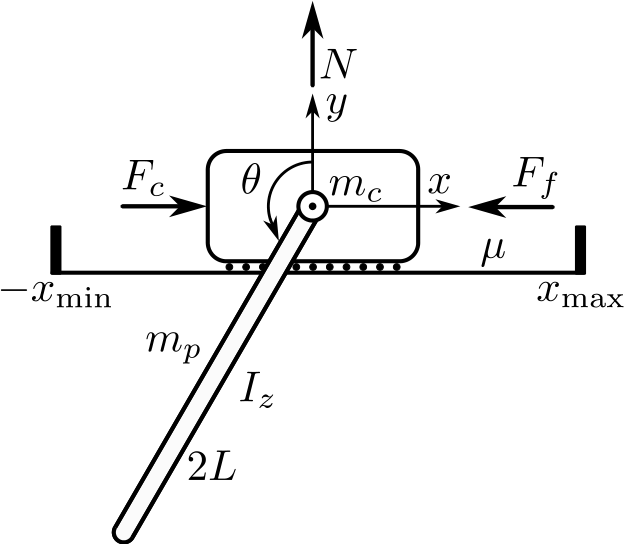
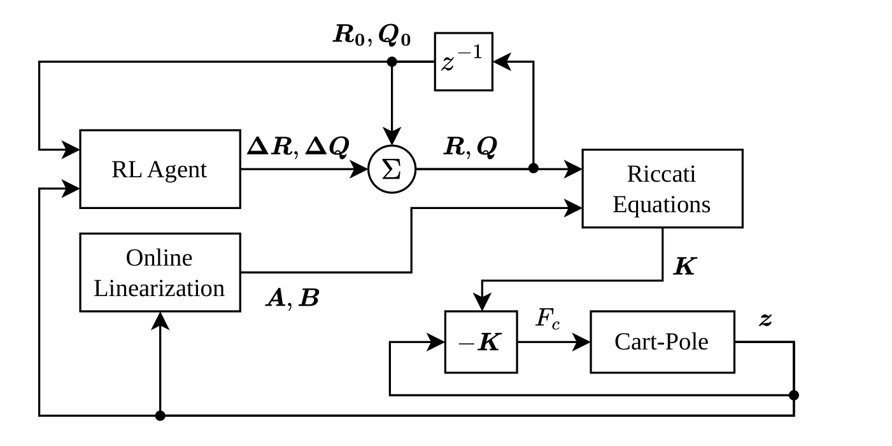
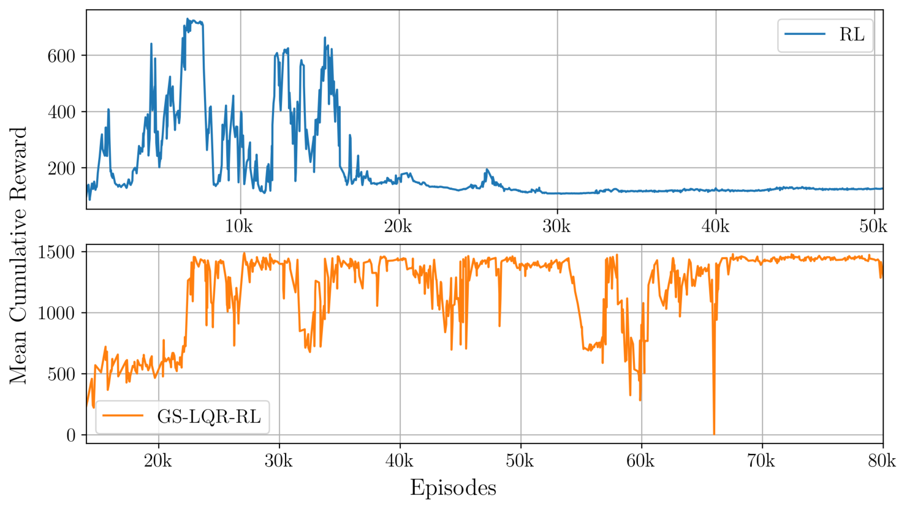

# Reinforcement Learning for Online Gain Scheduling in LQR - Application to the Cart-Pole

Arthur Henrique Iasbeck[0000-0003-2461-6769], Pedro Augusto Queiroz de Assis[0000-0002-7145-7847], Aldemir Aparecido Cavallini Junior[0000-0002-9647-2621], and Valder Steffen Junior[0000-0001-6124-2554]

Federal University of Uberlândia, Uberlândia - MG, 38408-100, Brazil
arthuriasbeck@ufu.br, pedro.assis@ufu.br, aacjunior@ufu.br, vsteffen@ufu.br

**Abstract.** This paper proposes the Gain-Scheduling Reinforcement-Learning-Based Linear Quadratic Regulator (GS-LQR-RL), a strategy for controlling nonlinear systems that integrates reinforcement learning with gain scheduling. The method employs the Twin Delayed Deep Deterministic Policy Gradient (TD3) algorithm to tune the Linear Quadratic Regulator (LQR) weighting matrices online, while concurrently re-linearizing the nonlinear plant at each time step around the current operating point. By computing feedback gains from a locally valid linear model, GS-LQR-RL preserves LQR stability properties and mitigates performance degradation caused by single-point linearization, eliminating the need for multiple predesigned controllers or interpolation rules. We evaluate the approach using the Cart-Pole benchmark under input constraints, comparing it against conventional Reinforcement Learning (RL) with direct force control and fixed-gain LQR. Simulation results demonstrate that GS-LQR-RL reduces the mean Integral of Squared Error (ISE) and Integral of Absolute Error (IAE) by 72% and 57%, respectively, relative to the fixed-gain LQR. Furthermore, GS-LQR-RL exhibits faster and more stable training dynamics, achieving near-maximum episode returns within approximately 70,000 episodes, whereas conventional RL fails to stabilize the system. These findings suggest that combining online linearization with RL-based weight adaptation offers a sample-efficient alternative for controlling nonlinear systems while maintaining LQR-like stability.

**Keywords:** Reinforcement learning · Gain scheduling · Linear quadratic regulator · TD3 · Online linearization · Cart-Pole

## 1 Introduction

Controlling nonlinear systems can be a challenging task, especially in the presence of underactuation and/or open loop unstable poles. Several techniques have been proposed in the literature for controlling this type of system, such as Sliding Mode Control [1], Feedback Linearization [1], Lyapunov-Based Control [1], and Nonlinear Model Predictive Control [2]. However, the design of nonlinear controllers typically requires careful tuning and analysis, often relies on the availability of a representative plant model, and may result in control systems that lack robustness to noise and unmodeled dynamics, or that produce oscillatory control actions capable of causing actuator wear [1].

An alternative to the design of nonlinear controllers lies in obtaining an equivalent linear model of the plant, derived from the linearization of the original model around an operating point. Proceeding in this manner simplifies the control system design and ensures local closed-loop stability [3]. Linearized models, however, are approximations that do not fully characterize system dynamics and remain valid only as long as the system state stays close to the operating point. Otherwise, the linear model no longer represents the system dynamics, and the closed-loop performance degrades [3]. In such cases, Gain Scheduling can be employed by designing multiple controllers, each tailored to a specific operating region.

The final controller is then obtained by interpolating these local controllers, which introduces some drawbacks. In particular, interpolation does not guarantee global stability, may induce unstable transients, and can degrade performance relative to the original controllers. Moreover, the need to design many controllers can substantially increase the complexity of both the control design process and the validation of closed-loop performance [4].

In order to overcome the limitations inherent to the use of linear controllers and the difficulties associated with the design of nonlinear controllers, Reinforcement Learning (RL) has been employed to control dynamic systems. In RL, an agent – interpretable in control applications as the controller – learns to act on a dynamical system through repeated interaction and trial-and-error. At each time step, the agent observes the system state, selects an action (system's input), and receives a scalar reward $r$ that quantifies the immediate desirability of the resulting behavior. The objective is to learn a policy that maximizes the expected cumulative reward over time. The reward function is specified by the control designer to encode the control objectives – such as regulation, tracking, constraint satisfaction, and energy usage – thereby shaping the learned behavior toward the intended task [5].

The literature presents various applications of RL to different types of systems such as unmanned aerial vehicles, nuclear fusion reactors, active vehicle suspensions, boiler–turbine systems, and electric vehicles [6–10]. Nevertheless, it is necessary to emphasize that this method does not guarantee closed-loop stability and may exhibit low sample efficiency, meaning that the training of an RL agent is, in most cases, a highly time-consuming process associated with a high computational cost [11].

In an effort to circumvent these limitations, Kozek *et al.* [11] propose a combination of Linear Quadratic Regulator (LQR) [3] and RL. In that paper, the RL agent defines the state and control weighting matrices (henceforth denoted by $\boldsymbol{Q}$ and $\boldsymbol{R}$, respectively) through which the LQR feedback matrix $\boldsymbol{K}$ is obtained. This approach removes the need for specialized knowledge of how $\boldsymbol{Q}$ and $\boldsymbol{R}$ influence the state variables, guarantees closed-loop stability, and produces a controller that adapts to changes in the system dynamics [11].

Despite these advantages, the method has some drawbacks. First, the gain $\boldsymbol{K}$ is always computed based on the linear model obtained from the linearization of the original model around a specific operating point, such that system performance deteriorates, even losing closed-loop stability guarantees, as the system state moves away from that operating point. Moreover, even when constraints are imposed to ensure that $\boldsymbol{Q}$ and $\boldsymbol{R}$ remain positive semidefinite, the agent may still violate them occasionally – especially during training – which can lead to closed-loop instability.

In this context, this work introduces a novel method that combines RL and LQR to control dynamic systems. Following Kozek *et al.* [11], we use RL to tune the LQR weighting matrices online. However, rather than relying on a model linearized at a single operating point, we linearize the system at every time step using the current operating point. We refer to this methodology as GS-LQR-RL (Gain-Scheduling Reinforcement-Learning-Based Linear Quadratic Regulator). Because the model used to compute the feedback gain $\boldsymbol{K}$ is always valid at the current operating point, the approach guarantees closed-loop stability and substantially improves sample efficiency during training. Like gain scheduling, GS-LQR-RL enables the design of a controller whose behavior adapts to the system's current operating point, without requiring the control designer to tune multiple controllers or resort to interpolation between them. GS-LQR-RL builds on Twin Delayed Deep Deterministic Policy Gradient (TD3), an extension of Deep Deterministic Policy Gradient that adopts an actor-critic architecture with two critics to mitigate value-function overestimation. TD3 also delays actor updates and smooths the actions used during training, which promotes more stable learning [12].

We evaluated the proposed control technique using the Cart-Pole system, a standard benchmark for control systems and RL algorithms [13]. The performance of GS-LQR-RL is compared against both a fixed-gain LQR and a traditional RL implementation – in which the agent directly dictates the system input.

The remainder of this paper is organized as follows: Section 2 describes the Cart-Pole system, Section 3 presents the control methods, Section 4 defines the reward function, Section 5 reports the results, and Section 6 concludes the paper with directions for future work.

## 2 System description

The Cart-Pole (illustrated in Fig. 1) is a nonlinear system composed of a cart that moves along a horizontal track and a rigid pendulum hinged to the cart. The system has two degrees of freedom: the cart horizontal position $x(t)$ and the pendulum angular displacement $\theta(t)$ measured with respect to the vertical direction (upright configuration). Herein, the manipulated input is the horizontal force $F_c(t)$ applied to the cart. The control task consists of regulating the pendulum around the upright equilibrium while regulating the cart position to the origin. Moreover, constraints on the cart position and the applied force are considered. That is, $|x(t)|\leq x_{max}$ and $|F_c(t)|\leq F_{c,max}$.

The initial conditions are assumed to be zero for all states, except for the pendulum angle, which is initialized at $\theta_0$. That is, $x(0)=\dot{x}(0)=\dot{\theta}(0)=0$ and $\theta(0)=\theta_0$.

It is worth noting that the Cart-Pole is widely used to evaluate the performance of control systems, including RL-based controllers. This benchmark is attractive for two main reasons. First, despite having a single input and two outputs and being described by relatively simple equations, the Cart-Pole is nonlinear, open-loop unstable, and underactuated, as it has more degrees of freedom than control inputs. Second, its dynamics resemble those of other systems that require active balancing, such as rockets during liftoff, bipedal robots, and two-wheeled vehicles (e.g., Segways) [13].

Mathematically, the dynamics of the Cart-Pole can be described as [14]

$$
\boldsymbol{M}(t)\ddot{\boldsymbol{q}}(t)=\boldsymbol{Q_b}(t), \quad \boldsymbol{q}(t)=\begin{bmatrix} x(t) & \theta(t) \end{bmatrix}^T, \tag{1}
$$

$$
\boldsymbol{M}(t)=\begin{bmatrix} m_c+m_p & -Lm_p\cos(\theta(t)) \\ -Lm_p\cos(\theta(t)) & m_pL^2+I_z \end{bmatrix}, \tag{2}
$$

$$
\boldsymbol{Q_b}(t)=\begin{bmatrix} -\dot{\theta}^2(t)m_pL\sin(\theta(t))+F_f(t)+F_c(t) \\ m_pgL\sin(\theta(t)) \end{bmatrix}, \tag{3}
$$

where $m_c$ denotes the mass of the cart, $m_p$ the mass of the pole (assumed to be uniform), $2L$ its length, $I_z$ the mass moment of inertia of the pole with respect to the axis passing through its center of mass, and $g$ the acceleration due to gravity. Since the pole is assumed to be uniform, it follows that $I_z=\frac{1}{3}m_pL^2$ [15]. Besides, it is assumed that the friction force $F_f(t)$ is proportional to the cart velocity $\dot{x}(t)$, the surface friction coefficient $\mu$, and the normal force $N$ acting on the cart, which in this case is assumed to be equal to $(m_c+m_p)g$. More precisely, we consider $F_f(t)=-\mu|N|\tanh(\dot{x}(t))$ [14].

All control systems introduced in Section 3 share the same objective: to regulate the Cart-Pole state vector $\boldsymbol{z}(t)=[x(t)\ \dot{x}(t)\ \theta(t)\ \dot{\theta}(t)]^T$. This implies that the system must start from a given initial state $\boldsymbol{z}_0=[0\ 0\ \theta_0\ 0]^T$ and reach, at the end of the simulation, the state $\boldsymbol{z}=\boldsymbol{0}$.

## 3 Reinforcement-Learning-Based Gain Scheduling for Linear Quadratic Regulator

Figure 2 illustrates the flowchart of the proposed control technique. At each discrete time step $k$, the RL agent observes the state vector $\boldsymbol{z}(k)=[x(k)\ \dot{x}(k)\ \theta(k)\ \dot{\theta}(k)]^T$ and the weighting matrices $\boldsymbol{Q}$ and $\boldsymbol{R}$, which are initialized as $\boldsymbol{Q_0}$ and $\boldsymbol{R_0}$, respectively. The agent then selects the actions $\boldsymbol{\Delta Q}$ and $\boldsymbol{\Delta R}$, which represent the increments of the diagonal elements of the weighting matrices. Subsequently, the algorithm updates the weighting matrices following $\boldsymbol{R}\leftarrow\boldsymbol{R}+\boldsymbol{\Delta R}$ and $\boldsymbol{Q}\leftarrow\boldsymbol{Q}+\boldsymbol{\Delta Q}$, and linearizes the nonlinear model around the current state $\boldsymbol{z}(k)$ to obtain
the state matrix $\boldsymbol{A}$ and input matrix $\boldsymbol{B}$ [3]. We then discretize $\boldsymbol{A}$ and $\boldsymbol{B}$ through the zero-order hold (ZOH) method [16] – given a sampling period $T$ – to obtain $\boldsymbol{A_d}$ and $\boldsymbol{B_d}$. Finally, solving the discrete algebraic Riccati equation (DARE) [16] yields the feedback gain matrix $\boldsymbol{K}$, allowing the calculation of the control law for the Cart-Pole system as $F_c(k)=-\boldsymbol{K}\boldsymbol{z}(k)$.

Assuming the $(\boldsymbol{A_d},\boldsymbol{B_d})$ pair remains stabilizable at every operating point, we must ensure that $\boldsymbol{Q}$ and $\boldsymbol{R}$ are symmetric and, respectively, positive semi-definite and positive definite. Otherwise, the system may lose its closed-loop stability guarantee. The GS-LQR-RL architecture enforces these constraints inherently. First, we restrict $\boldsymbol{Q}$ and $\boldsymbol{R}$ to diagonal matrices to guarantee symmetry. Second, we bound the diagonal elements of the weighting matrices to the $[10^{-3},1]$ interval, ensuring that $\boldsymbol{Q}$ and $\boldsymbol{R}$ satisfy their respective definiteness requirements.

**Fig. 1: Illustration of a Cart-Pole system (Adapted from *Kozek et al.* [11]).**

**Fig. 2: Schematic diagram illustrating the application of GS-LQR-RL to the control of the Cart-Pole system.**

The online linearization used to compute the Jacobian matrices $\boldsymbol{A}$ and $\boldsymbol{B}$ is based on Eq. (1). From this equation, it follows that $\ddot{\boldsymbol{q}}(t)=\boldsymbol{M}(t)^{-1}\boldsymbol{Q_b}(t)$. Since $\ddot{\boldsymbol{q}}(t)=[\ddot{x}(t)\ \ddot{\theta}(t)]^T$, we define the functions $f$ and $g$ such that $\ddot{x}(t)=f(\boldsymbol{z}(t),F_c(t))$ and $\ddot{\theta}(t)=g(\boldsymbol{z}(t),F_c(t))$. Therefore, the matrices $\boldsymbol{A}$ and $\boldsymbol{B}$ are computed as

$$
\boldsymbol{A}=\begin{bmatrix} 0 & 1 & 0 & 0 \\ \frac{\partial f}{\partial x} & \frac{\partial f}{\partial \dot{x}} & \frac{\partial f}{\partial \theta} & \frac{\partial f}{\partial \dot{\theta}} \\ 0 & 0 & 0 & 1 \\ \frac{\partial g}{\partial x} & \frac{\partial g}{\partial \dot{x}} & \frac{\partial g}{\partial \theta} & \frac{\partial g}{\partial \dot{\theta}} \end{bmatrix}\bigg|_{\overline{\boldsymbol{z}}=\boldsymbol{z},\,\overline{F}_c=0}, \quad \boldsymbol{B}=\begin{bmatrix} 0 \\ \frac{\partial f}{\partial F_c} \\ 0 \\ \frac{\partial g}{\partial F_c} \end{bmatrix}\bigg|_{\overline{\boldsymbol{z}}=\boldsymbol{z},\,\overline{F}_c=0}, \tag{4}
$$

where $\overline{\boldsymbol{z}}$ and $\overline{F}_c$ denote system states and control action at the linearization point [1].

## 4 The Reinforcement Learning Problem

In the RL framework, the control problem is cast as a sequential decision-making task. Specifically, the system is modeled as a Markov Decision Process, and the agent seeks a policy $\pi$ that maximizes the expected discounted return $E[\sum_{k=0}^{\infty}\gamma r(k)]$, where $0<\gamma<1$ is the so-called discount factor. RL agents are commonly parameterized by Artificial Intelligence models such as Artificial Neural Networks (ANNs), which are used, in particular, to implement GS-LQR-RL. During training, we optimize the ANNs weights to maximize the expected discounted return by (i) mapping the agent's observations to actions and (ii) estimating the expected return from each environment configuration [5].

Therefore, the reward function translates the control task into an optimization signal that guides policy learning. To ensure alignment with the control objectives defined in Section 2, we propose the following reward function $r(k)$:

$$
r(k)=\begin{cases} -1, & a_{\mathrm{conv}}=0 \\ r_b(k)-0.5, & \text{if } |x(k)|>x_{\max} \text{ or } |F_c(k)|>F_{c,\max} \\ r_b(k), & \text{otherwise} \end{cases} \tag{5}
$$

$$
r_b(k)=1-\left[w_x\phi\left(\frac{x(k)}{x_{\max}}\right)+w_\theta\phi\left(\frac{\theta(k)}{\theta_{\max}}\right)+w_{F_c}\phi\left(\frac{F_c(k)}{F_{c,\max}}\right)\right], \tag{6}
$$

where the function $\phi(\alpha)=\min(|\alpha|,1)$ clips the input, and the subscript max denotes the maximum allowable value for each variable. The terms $w_x$, $w_\theta$, and $w_{F_c}$, constitute user-defined weights. Furthermore, the binary flag $a_{\mathrm{conv}}$ indicates closed-loop stability, such that $a_{\mathrm{conv}}=1$ if the agent ensures stability and $a_{\mathrm{conv}}=0$ otherwise.

Each training episode consists of a simulation in which the agent interacts with the system for $t_{\mathrm{sim}}$ seconds. To reduce training time, the simulation terminates early when the algorithm detects closed-loop instability.

The term $r_b(k)$ rewards the agent for regulating $x(k)$ and $\theta(k)$ while maintaining low-amplitude control signals $F_c(k)$. Additionally, the composite reward $r(k)$ penalizes constraint violations and the synthesis of unstable controllers.

Notably, the reward function omits terms related to the feasibility of $\boldsymbol{Q}$ and $\boldsymbol{R}$. Such terms are unnecessary because the algorithm constrains the elements of these weighting matrices within the interval $[10^{-3},1]$ during the episodes.

## 5 Simulation Results

To evaluate the effectiveness of the proposed control method, we compared its performance with two baselines: traditional RL and fixed-gain LQR. In the traditional RL approach, the agent directly controls the force applied to the cart, $F_c$. To compute the gains for the fixed-gain LQR, we derived the weighting parameters $\boldsymbol{Q_{LQR}}$ and $\boldsymbol{R_{LQR}}$ from the steady-state values to which the $\boldsymbol{Q}$ and $\boldsymbol{R}$ parameters from GS-LQR-RL converged. We trained all agents using the reward function described in Section 4, maintaining identical hyperparameters and network architectures. Specifically for the traditional RL agent, we omitted the reward terms related to $\boldsymbol{Q}$ and $\boldsymbol{R}$.

The simulation and training parameters are listed in Tab. 1 [14]. The initial value $\theta_0$ is drawn from a uniform distribution over the interval $[-35^\circ,-5^\circ]\cup[5^\circ,35^\circ]$ at the beginning of each episode. Since TD3 is a deterministic method, it was assumed that the agent's actions were perturbed during training by a Gaussian noise with zero mean and standard deviation $\sigma_a$. This promotes exploration of the solution space and prevents the agent from becoming trapped in suboptimal solutions (or local minima) [12]. At each time step, we set
the convergence flag $a_{\mathrm{conv}}$ by monitoring the state magnitudes. If any of the system states exceed a given threshold value, we consider the closed-loop system unstable and set $a_{\mathrm{conv}}=0$.

The agents employ Multilayer Perceptron (MLP) architectures with three hidden layers of 200 neurons each for both the TD3 actor and critic networks. We utilize ReLU activation functions throughout all hidden layers, while the actor's output layer employs a hyperbolic tangent (tanh) function. Furthermore, we incorporate control signal saturation for $F_c$ during both the training and performance evaluation phases.

We conducted the training process using the SKRL (Software Kit for Reinforcement Learning) library [17] on an NVIDIA RTX 3060 GPU, leveraging 15,000 parallel environments to accelerate data collection. To ensure reproducibility, we have made the Python scripts used to generate the results in this section available at https://github.com/ArthurIasbeck/meder_2026.

Table 1: Simulation and training parameters.

| Parameter | Description | Value | Unit |
|:--:|:--:|:--:|:--:|
| $T$ | Sampling period | 0.02 | s |
| $t_{\mathrm{sim}}$ | Simulation duration per episode | 30 | s |
| $F_{c,\max}$ | Maximum admissible control-force magnitude | 20 | N |
| $x_{\max}$ | Maximum admissible cart-position magnitude | 1 | m |
| $\theta_{\max}$ | Maximum admissible pendulum-angle magnitude | 45 | ° |
| $\Delta Q_{\max}$ | Maximum admissible increment for the elements of $\boldsymbol{Q}$ | 0.04 | – |
| $\Delta R_{\max}$ | Maximum admissible increment for $\boldsymbol{R}$ | 0.04 | – |
| $m_c$ | Cart mass | 1 | kg |
| $m_p$ | Pole mass (assumed uniform) | 0.1 | kg |
| $L$ | Half pole length (pole length is $2L$) | 0.5 | m |
| $g$ | Acceleration due to gravity | 9.81 | m/s$^2$ |
| $\mu$ | Surface friction coefficient | 0.3 | – |
| $w_x$ | Weight for $x$ error penalty | 0.3 | – |
| $w_\theta$ | Weight for $\theta$ error penalty | 0.4 | – |
| $w_{F_c}$ | Weight for $F_c$ magnitude penalty | 0.3 | – |
| $\sigma_a$ | Standard deviation of Gaussian action noise | 0.2 | – |
| $\boldsymbol{Q_0}$ | Initial value for $\boldsymbol{Q}$ | diag(1.0, 0.01, 1.0, 0.01) | – |
| $\boldsymbol{R_0}$ | Initial value for $\boldsymbol{R}$ | 0.001 | – |
| $\boldsymbol{Q_{LQR}}$ | State weighting matrix for the LQR design | diag(1.0, 1.0, 1.0, 0.3) | – |
| $\boldsymbol{R_{LQR}}$ | Control effort weighting factor for the LQR design | 0.001 | – |

Fig. 3 shows the mean cumulative reward achieved by each agent during training. GS-LQR-RL exhibited substantially more stable training than RL, converging (within 70,000 episodes) to a cumulative reward of approximately 1500, which corresponds to the maximum reward achievable in a single episode. By contrast, the mean cumulative reward for RL does not indicate successful convergence, remaining at comparatively low values. GS-LQR-RL achieved relatively high cumulative rewards from the first episodes, whereas this behavior was not observed for RL. This outcome is expected, since LQR provides closed-loop stability guarantees.

Finally, GS-LQR-RL successfully stabilized the system—a task standalone RL failed to achieve—while significantly reducing the mean Integral of Squared Error (ISE) and Integral of Absolute Error (IAE) compared to the fixed-gain LQR. Across 1,000 distinct runs, GS-LQR-RL yielded mean ISE and IAE reductions of 72% and 57%, respectively, for the cart position $x(t)$. Meanwhile, the mean ISE and IAE values for the pole angle remained very low, showing only a marginal absolute increase, as indicated in Table 2.

Table 2: Performance metrics associated with the trajectories generated by the methods under analysis.

<table>
<thead>
<tr><th rowspan="2"></th><th colspan="2">$x$</th><th colspan="2">$\theta$</th></tr>
<tr><th>ISE</th><th>IAE</th><th>ISE</th><th>IAE</th></tr>
</thead>
<tbody>
<tr><td><b>Fixed-gain LQR</b></td><td>1.1642</td><td>2.0671</td><td>0.0309</td><td>0.1749</td></tr>
<tr><td><b>GS-LQR-RL</b></td><td>0.3248</td><td>0.8959</td><td>0.0418</td><td>0.1847</td></tr>
</tbody>
</table>

**Fig. 3: Evolution of the mean cumulative reward during training for each of the evaluated agents.**

## 6 Concluding remarks

In this paper, we propose GS-LQR-RL, a reinforcement-learning-assisted gain-scheduling strategy for LQR in which the agent tunes the weighting matrices online while the plant is linearized at each time step around the current operating point. By coupling TD3 with an LQR controller computed from the locally valid linear model, the proposed method preserves the stability properties of LQR while adapting to nonlinear operating regions without requiring multiple predesigned controllers or explicit interpolation rules.

Evaluated on the benchmark Cart-Pole system under input constraints, GS-LQR-RL demonstrated significant performance improvements over both a fixed-gain LQR and a traditional direct-action RL controller. Simulation results revealed that the proposed technique consistently ensured closed-loop stability – a task where conventional RL failed to converge – while achieving reductions of 72% and 57% in the mean Integral of Squared Error (ISE) and Integral of Absolute Error (IAE), respectively, compared to the fixed-gain LQR. Furthermore, the hybrid architecture drastically improved sample efficiency and training stability, allowing the agent to reach near-maximum cumulative returns within approximately 70,000 episodes.

Future work will address (i) extending the RL agent's role to adjust not only controller parameters but also an observer, which has not yet been explored; (ii) introducing integral action and using RL to tune the corresponding gains; (iii) assessing the robustness of the proposed methods in the presence of external disturbances, measurement noise, and parametric variations; and (iv) experimentally validating GS-LQR-RL, which is essential to confirm its practical applicability, particularly with respect to actuator limitations, delays, and unmodeled dynamics.

## 6.1 Acknowledgments.

The authors thank CNPq, FAPEMIG, CAPES (INCT-EIE) and CPFL for financial support. They also acknowledge Petrobras for technical and financial support through the R&D project PT-200.20.00169 (ROSS-Digital Twin), managed by CENPES/PDIDP/ESUP/TIS, and the support from Foz do Chapecó, Enercan, CPFL Energia, and CSC Energia via ANEEL R&D project PD-00642-0124/2024.

**Disclosure of Interests.** The authors have no competing interests to declare that are relevant to the content of this article.

## References

1. Jean-Jacques E. Slotine and Weiping Li. *Applied Nonlinear Control*. Prentice Hall, 1991.
2. Lars Grüne and Jürgen Pannek. *Nonlinear Model Predictive Control*. Communications and Control Engineering. Springer International Publishing, 2017.
3. Katsuhiko Ogata. *Modern Control Engineering*. Prentice Hall/Sp, 2010.
4. Wilson J. Rugh and Jeff S. Shamma. Research on gain scheduling. *Automatica*, 36(10), 2000.
5. Richard S Sutton and Andrew G Barto. *Reinforcement Learning: An Introduction*. MIT Press, 2015.
6. Muammer Ugur and Aydin Yesildirek. Improving control performance of tilt-rotor VTOL UAV with model-based reward and multi-agent reinforcement learning. *Aerospace*, 2025.
7. Jonas Degrave, Federico Felici, Jonas Buchli, Michael Neunert, and Brendan Tracey. Magnetic control of tokamak plasmas through deep reinforcement learning. *Nature*, 602:414–419, 2022.
8. Jiawei Wang, Huiru Guo, and Xiaohe Deng. Deep reinforcement learning–based control strategy for electro-hydrostatic active suspension. *SAE International Journal of Passenger Vehicle Systems*, 18(3):15–18–03–0016, 2025.
9. U. Kruthika and Surekha Paneerselvam. Novel multiagent reinforcement learning framework using twin delayed deep deterministic policy gradient for adaptive PID control in boiler turbine systems. *Scientific Reports*, 15:34558, 2025.
10. Reza Jafari, Pouria Sarhadi, Amin Paykani, Shady S. Refaat, and Pedram Asef. A TD3-based reinforcement learning algorithm with curriculum learning for adaptive yaw control in all-wheel-drive electric vehicles. *IEEE Access*, 13:127150–127169, 2025.
11. Mateusz Kozek, Adam Smoter, and Krzysztof Lalik. Neural-assisted synthesis of a linear quadratic controller for applications in active suspension systems of wheeled vehicles. *Energies*, 16(4):1677, 2023.
12. Scott Fujimoto, Herke van Hoof, and David Meger. Addressing function approximation error in actor-critic methods.
13. Olfa Boubaker. The Inverted Pendulum Benchmark in Nonlinear Control Theory: A Survey. *International Journal of Advanced Robotic Systems*, 10(5):233, 2013.
14. Camilo Andrés Manrique Escobar, Carmine Maria Pappalardo, and Domenico Guida. A Parametric Study of a Deep Reinforcement Learning Control System Applied to the Swing-Up Problem of the Cart-Pole. *Applied Sciences*, 10(24):9013, 2020.
15. Russell C. Hibbeler. *Engineering mechanics: dynamics*. Pearson, 14. ed edition.
16. Katsuhiko Ogata. *Discrete-time control systems*. Prentice-Hall, 2. ed. edition.
17. Antonio Serrano-Munoz, Dimitrios Chrysostomou, Simon Bøgh, and Nestor Arana-Arexolaleiba. skrl: Modular and flexible library for reinforcement learning. 2023.
