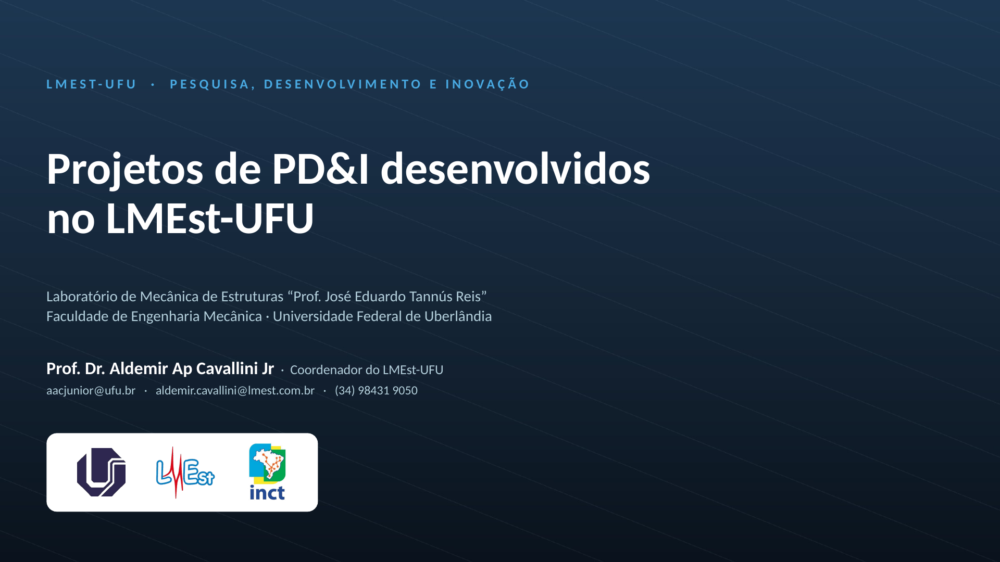
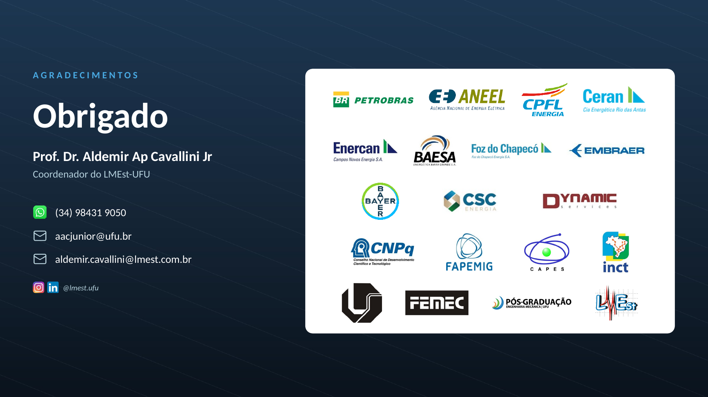

# Apresentações LMEst-UFU

Esta skill cria, reconstrói e revisa apresentações no padrão visual do
Laboratório de Mecânica de Estruturas da UFU (LMEst-UFU). A mesma identidade
visual pode ser entregue como PowerPoint editável (.pptx) ou como uma
apresentação HTML navegável.

O usuário fornece o conteúdo; o agente organiza os slides e escolhe
automaticamente a composição mais adequada entre os 19 slides da referência
editável [referencia_base.pptx](assets/references/referencia_base.pptx). Não
é necessário conhecer nem indicar layouts. A capa e os agradecimentos usam
estruturas fixas; os slides de conteúdo acompanham a ordem e a estrutura da
fonte.

## Uso rápido

1. Invoque a skill no Codex com <code>$apresentacoes-lmest</code> e anexe o conteúdo.
2. Diga se prefere **PPTX** ou **HTML**. Se não disser, o agente pergunta antes
   de montar. Se pedir os dois, cada formato é construído diretamente a partir
   da mesma fonte e do mesmo plano de conteúdo.
3. Responda a dúvidas sobre conteúdo ambíguo. Isso é especialmente importante
   para gráficos, equações, diagramas e dados de capa/agradecimentos extraídos
   de uma apresentação existente.
4. Receba o arquivo ou pacote final. A skill renderiza e inspeciona todos os
   slides antes de concluir.

Exemplos de pedido:

> <code>$apresentacoes-lmest</code> — Crie uma apresentação PPTX a partir do Markdown
> anexado. Use gráficos e diagramas quando ajudarem a explicar os resultados.

> <code>$apresentacoes-lmest</code> — Reconstrua este PPTX no padrão LMEst e entregue em
> HTML. Preserve o conteúdo visível e a ordem; pergunte se algum dado estiver
> ambíguo.

## Exemplos visuais

Estas imagens são prévias ilustrativas renderizadas do PPTX de referência. Elas
mostram a capa, a transição, um slide de conteúdo com blocos e os agradecimentos.
O arquivo PPTX editável continua sendo a fonte usada para a montagem; as
imagens desta seção existem apenas para documentação.

| Capa — referência 1 | Transição — referência 5 |
|---|---|
|  |  |

| Conteúdo em blocos — referência 3 | Agradecimentos — referência 19 |
|---|---|
|  |  |

## O que você pode fornecer

| Entrada | Quando usar | O que a skill faz |
|---|---|---|
| **Markdown + imagens** | Recomendada para conteúdo novo ou revisado | Lê estrutura, texto, equações e imagens; escolhe a composição visual de cada slide. |
| **PPTX existente** | Para reconstruir um deck com identidade visual diferente | Inventaria e renderiza cada slide, preserva o conteúdo visível e reconstrói o deck no padrão LMEst. |
| **PDF** | Quando não houver Markdown nem PPTX de origem | Cria um rascunho Markdown para revisar antes da montagem; esta entrada exige mais conferência. |

Se Markdown e PDF forem enviados juntos, o Markdown é usado. Notas do
apresentador e animações existentes em um PPTX não são extraídas. A origem
fornece conteúdo e significado, não sua decoração, tema, cores ou tipografia.

### Markdown: estrutura do arquivo

O arquivo principal deve se chamar apresentacao.md, slides.md,
presentation.md ou deck.md, ou ser o único Markdown no pacote. As imagens
devem estar no mesmo pacote/diretório ou ser anexadas separadamente. Caminhos
de imagem são relativos ao Markdown. Formatos aceitos: PNG, JPG/JPEG, WEBP,
SVG, GIF, BMP e TIFF. Imagens remotas e URLs data: não são aceitas; inclua os
arquivos locais.

O front matter YAML no início do arquivo fornece os dados da capa e do slide
final. <code>titulo</code> e <code>autores</code> são obrigatórios:

~~~yaml
---
titulo: Efeitos de não colocação em mancais magnéticos ativos
autores:
  - nome: Ana Ribeiro
    cargo: Mestranda · LMEst-UFU
    contatos: [ana.ribeiro@ufu.br, (34) 99999-0000]
    apresentador: true
  - nome: Prof. Dr. Carlos Lima
agradecimentos:
  cargo: Mestranda · PPGEM-UFU
  # contatos: [ana.ribeiro@ufu.br]
---
~~~

Use <code>apresentador: true</code> para indicar quem aparece na capa e nos contatos dos
agradecimentos. Sem essa indicação, o primeiro autor será usado. Os
agradecimentos herdam cargo e contatos do apresentador; é possível sobrescrever
os campos no bloco agradecimentos. A skill não inventa título, autor, cargo,
contato ou afiliação ausente: solicitará a informação necessária.

#### Dividir e descrever slides

- Um heading <code>#</code> inicia uma seção e pode gerar um slide de transição. A primeira
  linha de texto após o heading pode ser usada como subtítulo.
- Um heading <code>##</code> inicia um slide de conteúdo.
- Também é possível separar blocos de slide com uma linha <code>---</code>; o heading do
  bloco define se ele é seção/transição ou conteúdo. Não coloque separadores
  horizontais de outro tipo para simular uma descrição.
- O agente preserva a ordem do Markdown e escolhe a referência visual. Sem
  descrição visual, ele decide a estrutura do slide com base no conteúdo.

Use um blockquote Markdown logo após o heading (linhas em branco são
permitidas) para orientar a composição. Todas as linhas da descrição devem
começar com >:

~~~markdown
## Tempo por método

> Mostre um gráfico de barras com os valores 5, 10, 12 e 100.
> Use Newmark, Analítico, Redução modal e Original como categorias;
> o eixo de valores representa o tempo em minutos.

O método Original teve o maior tempo neste conjunto de resultados.
~~~

O texto dentro do blockquote é uma instrução visual; ele não aparece como texto
do slide. O conteúdo fica fora dos quotes. Blockquotes são reservados apenas a
descrições visuais: um blockquote vazio, fora dessa posição, ou usado como
citação/conteúdo interrompe a preparação com indicação da linha. Aspas normais
ou tipográficas no texto comum não são blockquotes. Para exibir uma citação
literal no slide, use texto comum com aspas, não o prefixo Markdown >.

Anotações opcionais:

- <code>&lt;!-- literal --&gt;</code> pede que o texto daquele slide não seja condensado.
- <code>&lt;!-- notas: texto --&gt;</code> adiciona notas do apresentador.

O agente pode condensar texto para manter a legibilidade, sem alterar números,
unidades, nomes, equações ou sentido; texto condensado é enviado às notas. Se
condensar puder mudar o sentido, o agente pergunta antes.

#### Equações e figuras

Escreva matemática em LaTeX, por exemplo \(k_s\) inline ou $$...$$ em
bloco. As equações são renderizadas em imagens de alta resolução e conferidas
contra a fonte antes da inserção. O agente trata valores monetários como texto;
para um cifrão ambíguo literal, use \$.

Inclua gráficos, fotos ou figuras como arquivos de imagem locais. Se o conteúdo
trouxer os dados subjacentes, a skill pode reconstruir o visual como gráfico ou
diagrama editável; se não houver dados suficientes para uma reconstrução fiel,
mantém a figura fornecida como imagem.

### PPTX: reconstruir um deck existente

Anexe o .pptx e indique o formato de saída. A skill extrai um inventário de
textos, tabelas, dados de gráficos, formas, conectores, mídias e candidatos a
equações, além de renderizar todos os slides da fonte. O agente compara o
inventário com cada render antes de compor.

O conteúdo visível e sua sequência são preservados. Um slide denso pode virar
vários slides LMEst; a ordem original é mantida. Tabelas e gráficos são
recriados como objetos editáveis quando seus dados estão disponíveis;
diagramas claros podem ser refeitos com formas e conectores. Imagens e recortes
da fonte permanecem como imagem quando não existe estrutura suficiente para
reconstrução fiel. Equações são transcritas para LaTeX e renderizadas.

Se houver texto ilegível, valor de gráfico incerto, equação duvidosa, relação
ambígua em um diagrama ou campo de capa/agradecimentos ausente, a skill pausa e
pergunta antes de gerar. Não deduz valores nem cria nomes, dados ou
agradecimentos. Se o deck não tiver capa ou encerramento claros, o usuário
ajuda a preencher os campos das páginas fixas LMEst.

### PDF: preparar e revisar o rascunho

Markdown com imagens originais costuma preservar melhor ordem, equações,
figuras vetoriais e dados de capa. Ao receber só um PDF, o agente explica essa
limitação e pergunta se o usuário prefere enviar Markdown; se não, continua
com o PDF, extrai texto e imagens e prepara um rascunho Markdown. O usuário deve
revisar a transcrição e as páginas renderizadas antes da montagem.

Na revisão, confira títulos, texto de cada página, ordem de leitura, imagens,
equações, capa e agradecimentos. Transcreva equações em LaTeX, confirme dados
de capa com o apresentador e resolva/remova marcações
<code>&lt;!-- conferir: ... --&gt;</code>. Não remova o marcador
<code>&lt;!-- RASCUNHO ... --&gt;</code> antes da segunda preparação. O
agente explicará esses pontos e poderá fazer a revisão junto com o usuário.

## Escolha do resultado: PPTX ou HTML

### PowerPoint (.pptx)

É a opção indicada quando o usuário precisa continuar editando formas, tabelas,
gráficos e textos no PowerPoint. Tabelas, gráficos e conectores recriados com
dados estruturados são objetos editáveis; formas e diagramas também são
compostos com recursos nativos sempre que possível.

### HTML

O HTML é construído diretamente — não é uma conversão do PPTX. Assim, cores,
tipografia, proporção, ordem, conteúdo, tabelas, gráficos, equações e marca
podem seguir o mesmo plano sem herdar limitações da conversão. O resultado é
uma pasta ou ZIP autônomo com index.html e recursos locais, que abre sem
internet.

A apresentação HTML mantém a tela 16:9 e usa CSS, HTML e SVG para diagramas e
gráficos. Ela inclui navegação por teclado e botões, contador, progresso e
tela cheia. Animações, revelação de etapas, tooltips ou detalhes expansíveis
são incluídos quando ajudam a compreensão; o conteúdo essencial continua
acessível sem interação, e movimento reduzido é respeitado. As imagens e
gráficos têm rótulos acessíveis. Se o usuário pedir PPTX e HTML, os dois são
produzidos separadamente a partir do conteúdo e plano compartilhados.

## Como o agente compõe os slides

O deck-base contém 19 referências numeradas. O agente compara conteúdo,
estrutura dos dados e intenção visual com as prévias e seleciona as
composições automaticamente. Uma referência pode ser reutilizada; se nenhuma
servir, o agente cria um slide limpo com cabeçalho, marca e rodapé LMEst.

Nos slides de conteúdo, a prioridade é explicar visualmente. O agente procura
formas, cartões, diagramas, fluxogramas, linhas do tempo, tabelas, gráficos,
plots e galerias de imagens que ajudem a ler o conteúdo. Usa elementos nativos
do PowerPoint ou HTML/SVG editável sempre que possível. Não força decoração e
não inventa números, etapas ou relações que a fonte não informa.

Recursos compatíveis incluem:

| Conteúdo | Recurso visual |
|---|---|
| Dados numéricos fornecidos | Gráfico de barras horizontais ou verticais, linhas ou dispersão |
| Valores categóricos extensos | Tabela editável |
| Conceitos ou grupos | Formas e cartões |
| Relações e sequência | Diagramas, fluxogramas e conectores retos ou ortogonais |
| Etapas no tempo | Linha do tempo ou cronograma |
| Equações | LaTeX conferido e renderizado |
| Imagens fornecidas sem dados reconstruíveis | Figura local, recortada quando necessário |

Não é necessário pedir um tipo de slide ou nomear uma referência. Se os dados
ou a relação que dariam base ao visual não estiverem claros, o agente pede
esclarecimento.

### Identidade visual

O canvas tem proporção 16:9 (1920 × 1080 px). O PowerPoint usa Calibri; o HTML
usa Calibri, Carlito ou Arial, sem carregar fontes pela internet. Estes são os
principais tokens de cor:

| Token | Hex | Uso típico |
|---|---|---|
| Navy | #152536 | Fundo escuro, cabeçalho e destaques |
| Texto | #1B2B3A | Texto principal em fundo claro |
| Azul | #1E88C7 | Dados e ênfases |
| Azul médio | #2F6690 | Ícones e títulos secundários |
| Ciano | #49A9E1 | Rótulos sobre fundo escuro |
| Vermelho | #C41E2A | Filete do cabeçalho e um destaque |
| Laranja | #E08A1E | Ressalvas pontuais |
| Borda | #D6DEE6 | Limites de cartões e tabelas |
| Superfície | #F3F5F8 | Cards e áreas claras |
| Superfície azul | #EAF4FB | Caixas informativas |
| Branco | #FFFFFF | Fundo claro e texto sobre navy |

Títulos de conteúdo usam aproximadamente 28 pt; introduções, 15–16 pt; texto
de corpo, 12,5–16 pt; legendas, 9–11 pt. Preserve contraste, espaço em branco
e a hierarquia dos exemplos. Se o texto não couber, o agente pode condensar
dentro das regras acima ou dividir o conteúdo em slides.

## Regras fixas de capa, transição e agradecimentos

- A capa LMEst é sempre o primeiro slide e preserva sua composição. O conteúdo
  editável inclui título, autoria, cargo e contatos claros.
- A transição é opcional. O slide de referência 5 pode ser inserido e
  reposicionado conforme as seções do Markdown ou o encadeamento do conteúdo.
- Agradecimentos LMEst são sempre o último slide e preservam a composição; o
  usuário pode atualizar nome, cargo e contatos nos campos previstos.
- Os outros slides seguem a ordem da fonte. Uma referência de conteúdo pode ser
  duplicada, e slides de origem densos podem ser divididos.

## Revisão visual e entrega

Antes de entregar, a skill:

1. Renderiza o PPTX de referência sob demanda para escolher layouts. Essas
   imagens são temporárias; o PPTX editável é a fonte da referência.
2. Gera o arquivo final, renderiza todos os slides como imagens e inspeciona
   cada página contra a referência escolhida. Para reconstrução de PPTX,
   compara também com o render e o inventário da apresentação de origem.
3. Confere proporção 16:9, ordem, legibilidade, texto e números, conteúdo de
   exemplo removido, gráficos/diagramas fiéis, equações, logos e cortes.
4. Testa a navegação e as interações HTML quando essa saída foi escolhida.
5. Corrige problemas em até três ciclos de edição, renderização e inspeção.

A comparação automática verifica estrutura e prepara imagens lado a lado; a
aprovação visual é feita pelo agente. Se uma limitação de renderização impedir
a inspeção, a skill informa isso e não declara a etapa como concluída.

## Dependências para execução local

No uso comum, o Codex executa a skill e resolve os caminhos do runtime. Para
rodar os scripts manualmente, o ambiente precisa de:

- Python 3.10 ou superior e as bibliotecas <code>python-pptx</code>,
  <code>lxml</code>, <code>Pillow</code>, <code>PyYAML</code> e
  <code>pdfplumber</code>;
- LibreOffice e Poppler (com <code>pdftoppm</code> e <code>pdftocairo</code>)
  para renderizar PPTX/PDF;
- TeX Live com <code>amsmath</code>, <code>mathtools</code> e
  <code>standalone</code> para renderizar equações; <code>lmodern</code> é
  recomendado;
- fonte Carlito para aproximar as métricas de Calibri durante a renderização;
- para HTML, Node.js, Playwright e Chromium instalados no runtime local do
  Codex. A skill não instala nem baixa um navegador automaticamente.

## Uso dos scripts (referência técnica)

O uso normal é pedir a apresentação ao agente com $apresentacoes-lmest e
fornecer o arquivo. Os comandos abaixo são úteis para quem estiver executando
ou mantendo a skill manualmente. <code>&lt;SKILL&gt;</code> é o diretório deste
repositório; <code>work/</code> é um diretório de trabalho separado, sem
alterar a entrada original.

### Preparar a entrada

~~~bash
python3 <SKILL>/scripts/prepare_input_bundle.py apresentacao.zip work
python3 <SKILL>/scripts/prepare_input_bundle.py apresentacao.md work --imagens imagens/
python3 <SKILL>/scripts/prepare_input_bundle.py apresentacao_fonte.pptx work
python3 <SKILL>/scripts/prepare_input_bundle.py conteudo.pdf work
~~~

O resultado principal é work/input_manifest.json. Para PPTX, as imagens de
origem ficam em work/source_render/ e as mídias extraídas em
work/extracted/pptx_media/. Para PDF, a primeira execução cria
work/pdf_rascunho/apresentacao.md; depois da revisão, execute novamente sobre
work/pdf_rascunho/.

### Renderizar a referência e equações

~~~bash
python3 <SKILL>/scripts/render_deck.py \
  <SKILL>/assets/references/referencia_base.pptx work/reference_render
python3 <SKILL>/scripts/render_equations.py \
  work/extracted/apresentacao.md work/equacoes
~~~

O primeiro comando gera imagens temporárias da referência. O segundo detecta
matemática inline e em bloco e gera equations_manifest.json junto às imagens
PNG. Execute-o quando houver equações.

### Renderizar e comparar a saída

Para PPTX:

~~~bash
python3 <SKILL>/scripts/render_deck.py work/deck.pptx work/render
python3 <SKILL>/scripts/evaluate_render.py work/render \
  --plano work/deck_plan.json --referencias work/reference_render
~~~

Para comparar a reconstrução com PPTX de origem, acrescente
--entrada-pptx-render work/source_render ao segundo comando.

Para HTML, use o Node.js, Playwright e Chromium já disponíveis no runtime local
do Codex. Configure NODE e NODE_MODULES com os caminhos desse runtime:

~~~bash
NODE_PATH="$NODE_MODULES" "$NODE" \
  <SKILL>/scripts/render_html_deck.cjs work/html/index.html work/html_render
~~~

Se Chromium não estiver instalado, não o baixe automaticamente. A inspeção
visual HTML fica pendente até haver um renderizador permitido disponível.

### Códigos de saída da preparação

| Código | Significado | Ação |
|---:|---|---|
| 0 | Preparação concluída | Continue para planejar e compor. |
| 2 | Imagem referenciada ausente | Inclua a imagem ou corrija o caminho. |
| 3 | Dados obrigatórios de capa ausentes/ambíguos | Complete titulo e autores no front matter. |
| 4 | Pacote, Markdown principal ou PPTX inválido/não renderizável | Corrija a entrada ou escolha o arquivo principal. |
| 5 | PDF convertido em rascunho Markdown | Revise o rascunho e execute a preparação novamente sobre ele. |
| 6 | Blockquote vazio, deslocado ou reservado usado incorretamente | Corrija a descrição visual e sua posição. |

## Arquivos da skill

~~~text
SKILL.md                         instruções centrais e fluxo de decisão
manifest.json                    catálogo das referências e tokens visuais
assets/references/referencia_base.pptx
                                 apresentação editável usada como referência
assets/references/refs_description.md
                                 catálogo interno dos 19 slides
assets/html/                     CSS e runtime de navegação HTML
docs/                            guias detalhados de entradas, design e QA
docs/images/readme/              imagens ilustrativas desta documentação
scripts/                         preparação, extração, montagem, render e QA
examples/                        Markdown e código de exemplo
~~~

Guias complementares: [entrada Markdown](docs/entrada_markdown.md),
[reconstrução de PPTX](docs/entrada_pptx.md), [saída HTML](docs/saida_html.md),
[sistema visual](docs/design_system.md), [slides fixos](docs/slides_rigidos.md),
[equações](docs/equacoes.md) e [QA](docs/qa.md).
