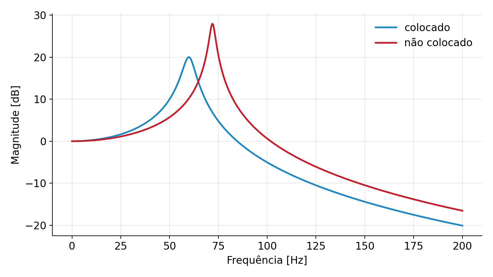

# Fundamentos

Modelo do atuador e da malha de controle

---

## Modelo linearizado do atuador

> Organize as equações em sequência vertical, com uma frase introdutória curta acima delas.

A força magnética é linearizada em torno do ponto de operação, com rigidez de
posição $k_s$ e ganho de corrente $k_i$:

$$
\begin{gathered}
F = k_s x + k_i i \\
i = \mathbf{C_c x_c} - \mathbf{D_c} x
\end{gathered}
$$

O rotor segue a equação de movimento clássica:

$$
\mathbf{M\ddot{x}} + \mathbf{C\dot{x}} + \mathbf{Kx} = \mathbf{F}
$$

<!-- notas: Comentar que k_s é negativo (rigidez de posição instável). O custo do protótipo foi de R$ 120 mil. -->

---

## Resposta em frequência

Com sensor e atuador em planos diferentes, surge um modo com fase invertida
perto de 70 Hz.



- Colocado: modo bem amortecido em 60 Hz
- Não colocado: pico estreito e margem de fase reduzida
- Orçamento de R$ 15 mil para o novo sensor

```python
# trecho de código: o $ abaixo não é equação
custo = "$x$"
```
