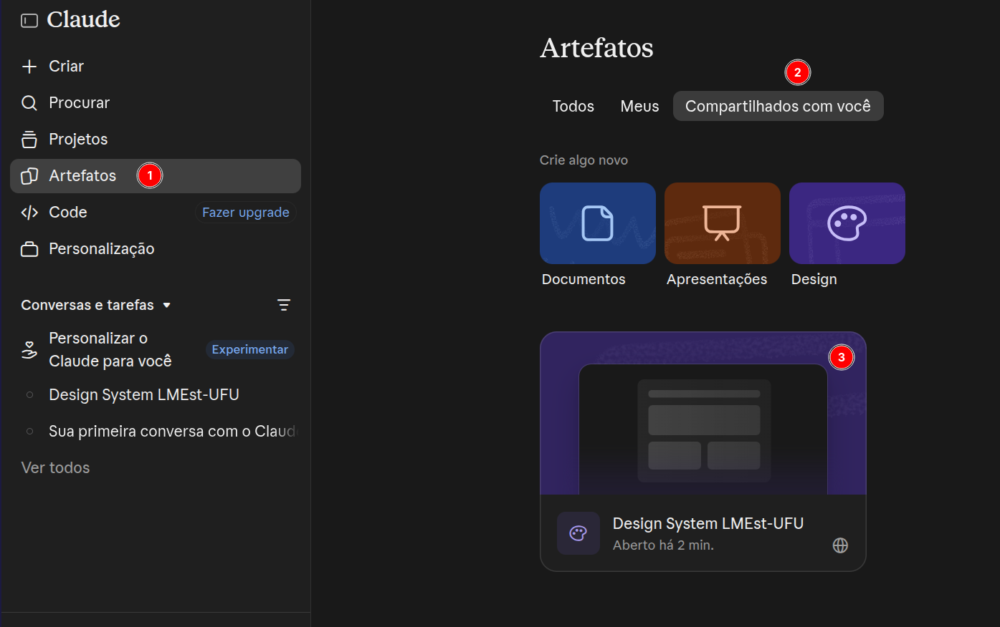
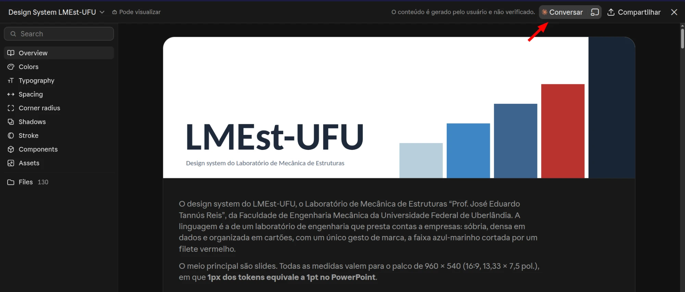
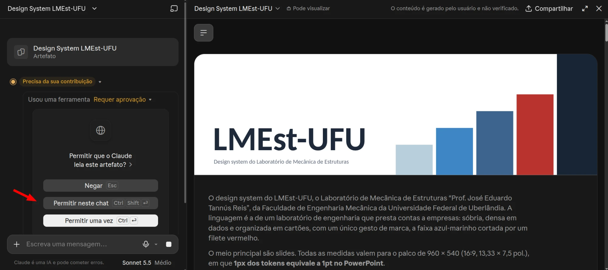

# lmest-relatorio-html

Skill do Claude Code que transforma um material técnico (nota em Markdown/Obsidian, zip com anexos, PDF ou PPTX) em um relatório HTML único e offline, com a identidade visual do LMEst-UFU: capa institucional, índice lateral, figuras ampliáveis e equações em LaTeX.

## Como usar

1. Baixe a pasta da skill (`lmest-relatorio-html`).
2. Coloque-a em `~/.claude/skills/`, de modo que exista `~/.claude/skills/lmest-relatorio-html/SKILL.md`. Em um projeto, ela também pode ficar em `.claude/skills/` dentro da pasta do projeto.
3. Abra o Claude Code, envie (ou indique o caminho do) material de referência e peça o relatório. Exemplo:

   ```text
   Crie um relatório HTML do LMEst com base neste material: ~/Documentos/relatorio_2026-10-29.zip
   ```

   Ou, com um PDF ou PPTX:

   ```text
   Gere um relatório HTML do LMEst a partir de ~/Documentos/apresentacao.pptx
   ```

4. Peça ajustes, se precisar. Por exemplo:
   - Coloque as duas figuras de espectro lado a lado.
   - Destaque a equação da força em um painel.
   - Troque o título da seção de resultados.

O relatório é salvo ao lado do material (ou onde você pedir), e o Claude informa os pontos a confirmar.

## Requisitos

- Sempre: Python 3 com Pillow e pandoc.
- Para PPTX: python-pptx e LibreOffice.
- Para PDF: poppler-utils.

```bash
pip install Pillow python-pptx
sudo apt install pandoc libreoffice poppler-utils
```

## Alternativa: usar o Design System direto no Claude

Sem instalar a skill, dá para pedir o documento ao Claude (claude.ai) usando o Design System do LMEst, compartilhado como artefato.

1. Acesse o link: https://claude.ai/artifact/QyGsUH1VCCj4CqknL22zyY
2. Em **Artefatos > Compartilhados com você**, abra **Design System LMEst-UFU**.

   

3. Clique em **Conversar**.

   

4. Quando o Claude perguntar se pode ler o artefato, clique em **Permitir neste chat**.

   

5. Peça o documento. Exemplo:

   ```text
   Crie uma apresentação (ou um relatório) com o Design System do LMEst, com base neste material: [anexe o arquivo ou cole o texto]
   ```

Os requisitos acima valem só para a skill.
